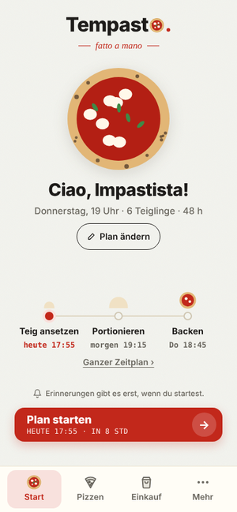
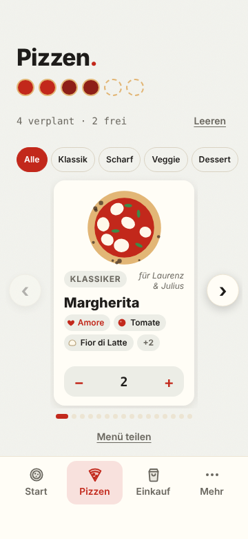
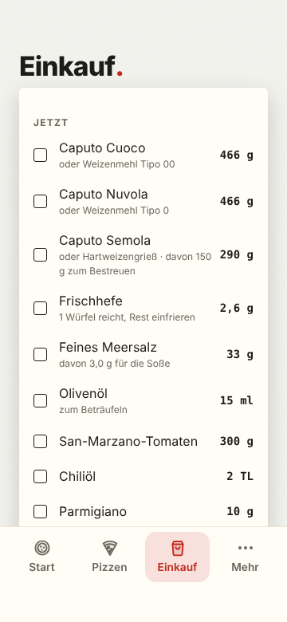
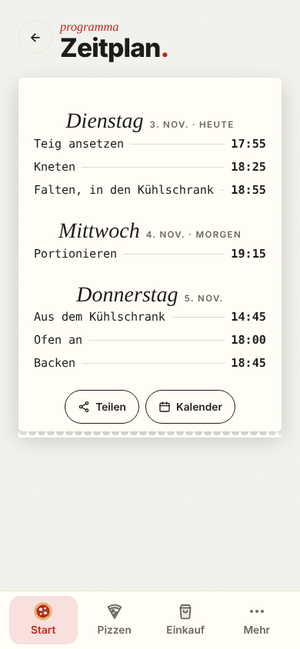
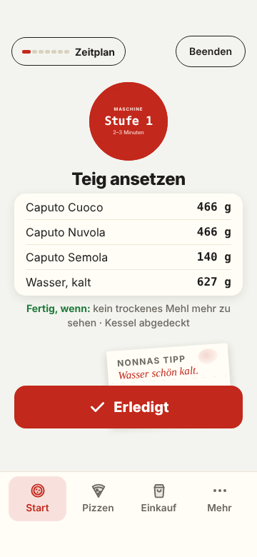
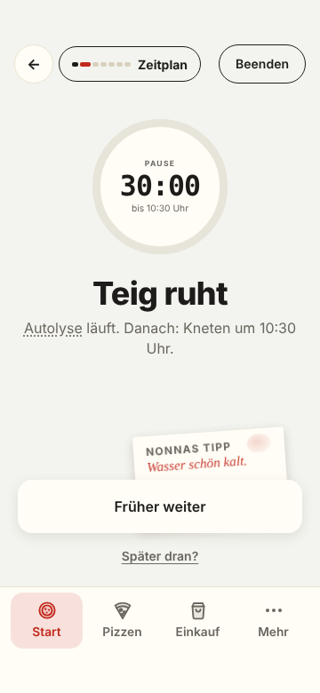

# Tempasto · fatto a mano

**Der Teigplaner für neapolitanische Pizza.** Du sagst, wann gegessen wird, und Tempasto sagt dir, wann du was tun musst: vom Wasser-Kaltstellen bis zur letzten Pizza aus dem Ofen.

Kostenlos, ohne Werbung, ohne Konto. Deine Daten bleiben auf dem Handy. Auf Deutsch und Englisch.

<p>
  
  
  
  
  
  
</p>

---

## Warum es Tempasto gibt

Der Name verbindet *tempo* und *impasto*, die Zeit und den Teig. Mehr braucht guter Pizzateig nicht, aber die Zeit muss stimmen.

Neapolitanischer Teig braucht 24 bis 72 Stunden. Die Frage ist nie *wie*, sondern *wann*: Wann muss der Teig angesetzt werden, damit am Donnerstag um 19 Uhr gegessen wird? Wann portionieren, wann aus dem Kühlschrank, wann den Ofen an?

Tempasto rechnet das rückwärts aus und begleitet dich dann Schritt für Schritt durch den ganzen Teig.

Tempasto macht genau eine Sache: neapolitanische Pizza. Keine Pinsa, kein Blech-Focaccia, kein New-York-Style.

## Was die App kann

**Planen**
- Auf der Startseite steht dein Plan als Satz: *Wir essen am Donnerstag um 19 Uhr 6 Pizzen. Der Teig geht 48 Stunden.* Jeder unterstrichene Teil lässt sich antippen und ändern
- Darunter die drei wichtigsten Schritte mit Uhrzeit und der Knopf *Plan starten* mit Countdown bis zum Teigansetzen
- Die App rechnet rückwärts, auch die Backzeit aller Pizzen, und passt die Hefe an Gehzeit und Kühlschranktemperatur an
- Erst *Plan starten* schaltet die Erinnerungen ein: ans Wasser, ans Teigansetzen und an jeden weiteren Schritt
- Beim ersten Start eine Liste *Bevor es losgeht* mit allem, was du brauchst
- Läuft etwas anders: *Später dran?* verschiebt den restlichen Plan samt Erinnerungen
- Vorlagen wie „Freitagspizza“ speichern und für den nächsten passenden Termin übernehmen
- Der Zeitplan zeigt alle Schritte mit Ruhezeiten im Kühlschrank ❄ und bei Raumtemperatur ⌂ und lässt sich teilen oder in den Kalender übernehmen

**Rezept und Ofen**
- Im normalen Modus: Ofen, Teigling-Größe, Hefe, Hydration als Schieberegler, Kneten mit Maschine oder von Hand, Nachtruhe
- Im Expertenmodus zusätzlich: Vorteig (ohne, Poolish oder Biga), Mehlmischung (auch eine eigene aus bis zu drei Mehlen), Kühlschranktemperatur, Raumtemperatur, Zuschlag für Teigreste, Ofenhitze und Backzeit
- Nachtruhe: In diesem Zeitfenster plant die App keine Handgriffe für dich

**Pizzen und Einkauf**
- Pizzen von der Karte wählen, gefiltert nach Klassik, Scharf, Veggie und Dessert, oder eigene zusammenstellen
- Menü als Bild teilen. Du legst fest, welche Pizzen deine Gäste zur Auswahl sehen
- Die Einkaufsliste schreibt sich selbst, in Gramm, mit Ersatz aus dem Supermarkt
- Getrennt nach „Jetzt“ und „Frisch kaufen“, damit Mozzarella und Basilikum nicht zu früh im Kühlschrank liegen

**Backen**
- Der Backmodus führt durch jeden Schritt: Mengen, Handgriffe und „Fertig, wenn …“
- Die Knöpfe unten stehen auf jeder Seite an derselben Stelle
- Hinter *Erledigt* steckt bei jedem Schritt ein Zettel von Nonna. Antippen, und sie erklärt den Schritt ausführlich: was du brauchst, Schritt für Schritt, ihr Tipp
- Pausen laufen mit Countdown, lange Gare mit wachsendem Teigling
- Die Farbe zeigt die Phase: kühles Blau im Kühlschrank, warmes Beige bei Raumtemperatur
- Ofenprofil für Gas-, Holz- und Elektro-Pizzaofen, Backofen mit Stein oder Blech
- Ofen-Timer für mehrere Pizzen gleichzeitig, mit Hinweis zum Drehen
- Fachbegriffe wie Autolyse oder Stückgare lassen sich antippen und werden erklärt
- Ellbogen-Modus: lange irgendwo drücken heißt *Erledigt*, wenn die Hände voller Teig sind

**Android-App**
- Erinnerungen auch bei geschlossener App, mit *Erledigt* und *+10 Min* direkt in der Benachrichtigung
- Antippen der Erinnerung öffnet den aktuellen Schritt
- Bildschirm bleibt im Backmodus an
- Teig versehentlich abgebrochen? 10 Sekunden lang lässt sich das rückgängig machen
- Passt sich an Handy und Tablet an, läuft komplett offline
- Deutsch oder Englisch: richtet sich nach der Gerätesprache, umschaltbar oben unter *Mehr*

## Das Rezept

Tempasto arbeitet mit einem festen neapolitanischen Grundrezept:

| | |
|---|---|
| Mehl | Tempasto-Mix (Caputo Cuoco, Nuvola, Semola 1.000 : 1.000 : 300), klassisch Tipo 00, mit Vollkorn oder eigene Mischung |
| Hydration | 58 bis 70 % |
| Salz | 2,8 % aufs Mehl |
| Öl | keins im Teig, wie in Neapel |
| Hefe | frisch oder trocken, von der App berechnet |
| Teiglinge | 250, 280 oder 300 g |
| Gehzeit | 24, 48 oder 72 Stunden |
| Vorteig | optional: Poolish (30 % des Mehls, gleich viel Wasser, 12–20 h bei 18–20 °C) oder Biga (40 % des Mehls, 50 % Wasser, 14–22 h bei 16–18 °C) |

Ablauf: Teig ansetzen, Autolyse, Kneten, Falten und ab in den Kühlschrank, Portionieren, Aus dem Kühlschrank, Ofen an, Backen.

## Installieren

Tempasto gibt es (noch) nicht im Play Store. Die fertige APK liegt unter **[Releases](../../releases)**.

1. Die neueste `Tempasto-….apk` auf dem Handy herunterladen
2. Beim ersten Mal erlauben, dass der Browser Apps installieren darf
3. Installieren und Benachrichtigungen zulassen

Updates werden über die installierte Version gespielt, die Daten bleiben erhalten.

**Umstieg von der alten Impasto-App:** Die App heißt jetzt `de.tempasto.app` und wird neben der alten installiert. Plan, eigene Pizzen und Vorlagen legst du in Tempasto neu an, danach kann die alte App weg.

## Technik

- Die App ist eine einzelne HTML-Datei ohne Framework: `www/index.html` auf Deutsch, dazu `www/en.html`, `www/it.html`, `www/fr.html` und `www/es.html`
- Die Sprachfassungen werden aus der deutschen erzeugt (`tools/i18n/build_lang.py`), die Übersetzungen stehen in `tools/i18n/`
- Für Android wird sie mit [Capacitor](https://capacitorjs.com) verpackt
- Native Funktionen: Benachrichtigungen, Teilen, Dateien, Bildschirm-an, Zurück-Taste
- Die Verbindung zwischen App und Android steckt in `www/bridge.js`
- Gespeichert wird nur lokal auf dem Gerät

```
www/            Die App (HTML, Brücke zu Android, Schriften)
android/        Android-Projekt (Capacitor)
tools/          Hilfsskripte zum Bauen von www/, der englischen Fassung und der App-Symbole
.github/        Bauanleitung für GitHub Actions
docs/           Screenshots
```

## Selbst bauen

Die APK wird über GitHub Actions gebaut, und zwar nur auf Knopfdruck:

**Actions → APK bauen → Run workflow**

Nach etwa 5 bis 10 Minuten liegt die signierte APK unter *Releases*.

Signiert wird mit einem Schlüssel, der nicht im Repository liegt, sondern als GitHub-Secret hinterlegt ist (`KEYSTORE_BASE64`, `KEYSTORE_PASSWORD`, `KEY_ALIAS`, `KEY_PASSWORD`). Wer das Projekt selbst baut, braucht einen eigenen Schlüssel.

Lokal geht es mit Node 22, JDK 21 und dem Android SDK:

```bash
npm ci
npx cap sync android
cd android && ./gradlew assembleRelease
```

## Datenschutz

Tempasto sammelt keine Daten und sendet nichts an den Entwickler. Planung, Pizzen und Einstellungen liegen nur auf deinem Gerät.

## Lizenz

Der Code steht unter der [MIT-Lizenz](LICENSE). Die Schriften (Bricolage Grotesque, Figtree, IBM Plex Mono) stehen unter der SIL Open Font License, Capacitor unter der MIT-Lizenz.

---

*Tempasto · fatto a mano* von Maximilian Welter
